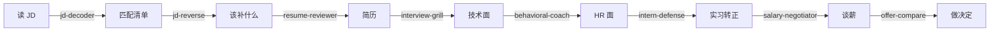

<div align="center">

# Quiver

### 求职季开箱即用的 13 个 Agent Skills

*不知道从哪开始？先说一句「我该先干什么」，`quiver-router` 会告诉你现在该做的那一件事*

[](https://github.com/WsNodeX/quiver/stargazers)
[](https://github.com/WsNodeX/quiver/releases)
[](LICENSE)

</div>

```
 看不懂 JD        简历投不出       面试被追问        拿到 offer
 ┌────────┐      ┌────────┐      ┌────────┐      ┌────────┐
 │ 拆要求 │ ───▶ │ 改材料 │ ───▶ │ 模拟考 │ ───▶ │ 谈条件 │
 └────────┘      └────────┘      └────────┘      └────────┘
  jd-decoder      resume-         interview-      salary-
  jd-reverse      reviewer        grill           negotiator
                  readme-booster  grill-java      offer-compare
                                  behav.-coach    intern-defense
```

---

不是又一份提示词合集。每个 skill 都定义了完整的工作流程、固定输出格式和行为红线 —— 装上就能用，不用先学怎么问。

## 快速开始

```bash
git clone https://github.com/WsNodeX/quiver.git && cd quiver
python scripts/install.py --all                    # 装进 ~/.claude/skills/
python scripts/install.py --all --client codex     # 或装进 Codex
./install.sh                                       # 或者让脚本自己找客户端
```

装好后在客户端里说「帮我模拟面试」「这周周报写一下」，对应 skill 自动触发。

装了什么、按什么顺序用，见 [SKILLS.md](SKILLS.md)。

## 13 个 skill

**先用这一个判断你现在该做什么：**

| Skill | 什么时候用 | 输出什么 |
|---|---|---|
| `quiver-router` | 不知道从哪开始 / 12 个太多不知道用哪个 | 定位你现在的阶段，只给**一件事**和对应的 skill，并说清做别的会浪费在哪 |

**然后按处境往下走：**

| Skill | 什么时候用 | 输出什么 |
|---|---|---|
| `jd-decoder` | 拿到一份 JD，想知道它真正在要什么 | 硬性要求权重表 + 隐含期待 + 面试考点预测 + 匹配度清单 |
| `jd-reverse` | 想投某个方向，不知道该学什么 | 从 5-10 份同类 JD 反推技能树，按依赖关系排学习路径 |
| `resume-reviewer` | 简历投出去没回音 | 逐条改写对照表（原文 → 改后 → 理由）+ 三级优先级 |
| `readme-booster` | 项目不错但 README 劝退 | 五维诊断 + 整份改写稿 |
| `interview-grill` | 背了八股但不知道自己会不会 | 严格面试官多轮追问，结束给四维评分 + 背诵痕迹点 |
| `grill-java` | 专攻 Java 后端八股 | JVM / 并发 / 集合 / Spring / MySQL / Redis / MQ 分模块拷问 |
| `behavioral-coach` | HR 面不知道怎么讲经历 | STAR 重构 + 宝洁八大问题库覆盖 + 三向追问预演 |
| `take-home-reviewer` | 笔试作业要提交了，心里没底 | 按「面试官会怎么看」逐项检查，区分必挂 / 影响评价 / 加分 |
| `offer-compare` | 多个 offer 选不定 | 八维度加权打分 + 每个选项的真风险 + 选择困难破解法 |
| `salary-negotiator` | 拿到 offer 要谈薪 | 总包拆解 + 谈判区间 + 三句话术 + HR 反问应对 |
| `intern-defense` | 实习转正要答辩 | 一句话主线 + 2-3 件事展开 + 预判质疑 + 30/60/90 计划 |
| `weekly-report` | 实习周报不知道写什么 | 把流水账翻译成推进了什么，风险与下周计划结构化 |

## 装到哪些客户端

同一份内容分发给六个客户端，因为每个客户端只认自己那套发现路径：

| 客户端 | 入口 |
|---|---|
| Claude Code | `.agents/skills/<name>/SKILL.md` + `.claude-plugin/plugin.json` |
| Codex CLI | `.agents/skills/<name>/SKILL.md` |
| Cursor | `.cursor/rules/<name>.mdc` |
| Cline | `.clinerules/<name>.md` |
| Gemini CLI | `.gemini/commands/<name>.toml` |
| 其他 Agent | `.agents/skills/<name>/SKILL.md` |

`scripts/distribute.py` 一次生成全部入口；`scripts/validate.py` 逐字节比对镜像和源文件 —— 不一致就意味着某个客户端静默加载旧版本。

## 一条完整的求职链



## 设计原则

每个 skill 写的是「怎么一步步做」，不是「你是一个资深 HR」；输出格式固定，多次结果可以直接对比；行为红线写死「不做什么」——不编数据、不剧透答案、不替你撒谎；全部脚本零依赖，只用 Python 标准库。

## 目录结构

```
skills/<name>/SKILL.md  ← 唯一真源      .agents/ .cursor/ .clinerules/ .gemini/  ← 生成的入口
scripts/{distribute,validate,install}.py     tests/  ← 26 个分支测试
```

## 测试

```bash
python scripts/validate.py                # 13/13 合规 + 产物一致
python -m unittest discover -s tests      # 26 个分支测试
```

## 限制

- **中文场景为主**：提示词和输出模板按国内求职语境写（Boss 直聘、牛客、八股、内推、实习转正）。英文市场需要改写。
- **它给结构，不给答案**：简历里的量化数字、薪资谈判的底价、offer 的权重，都必须你自己填。skill 刻意不代劳——编出来的数字会在面试里露馅。
- **不编造市场数据**：谈薪和 offer 对比里不给「行业百分位」这种看起来精确但没来源的数字，只给基于级别与城市的推断并标注。

## 许可证

[MIT](LICENSE)
